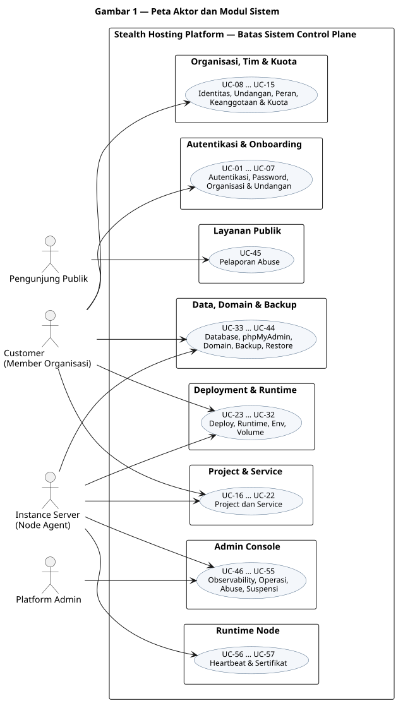
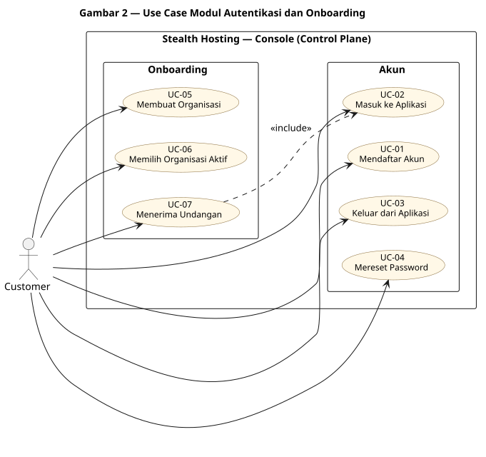
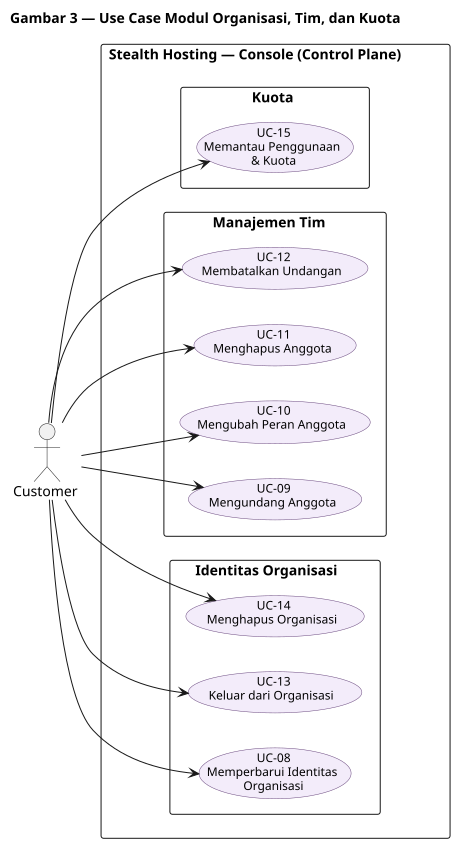
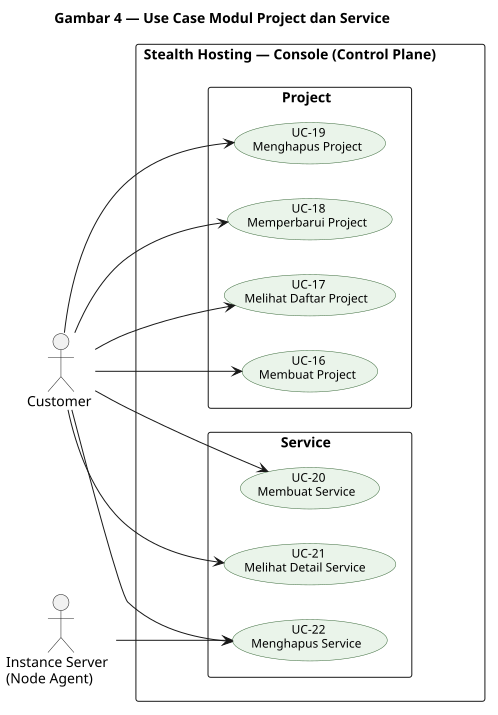
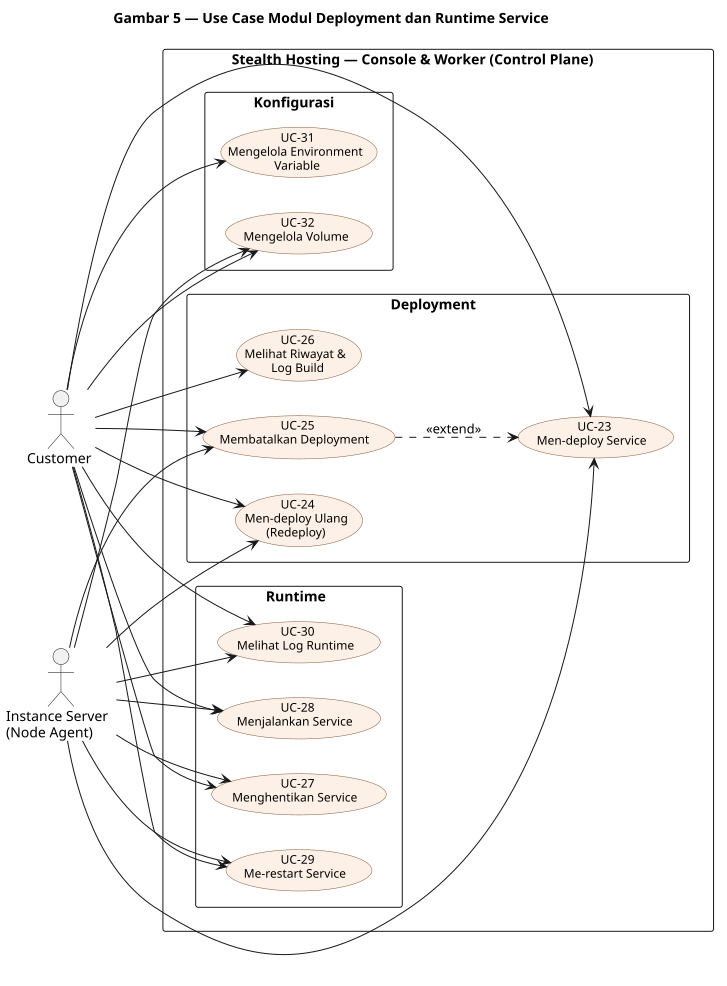
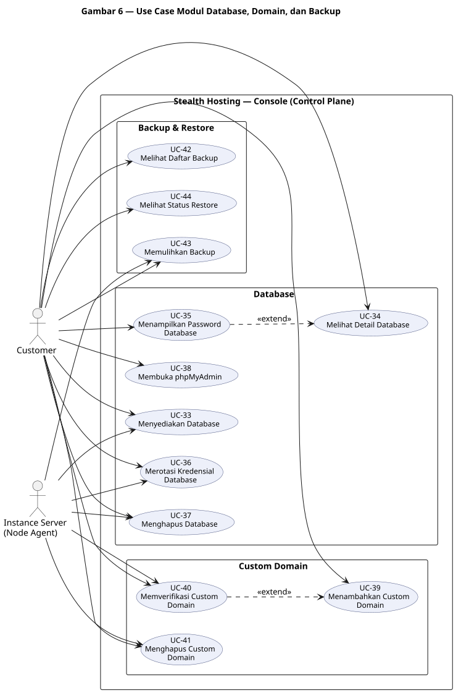
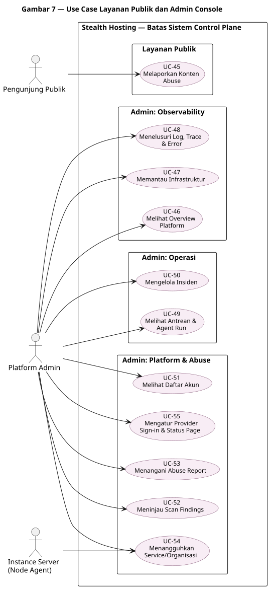
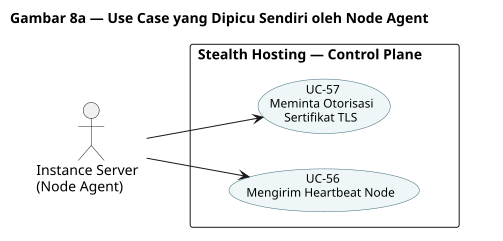
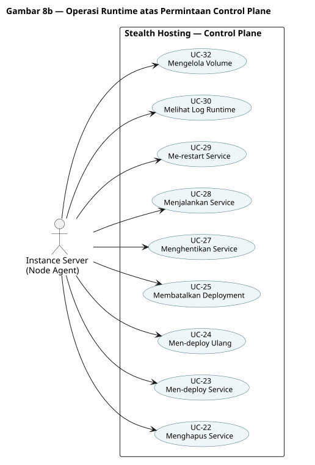
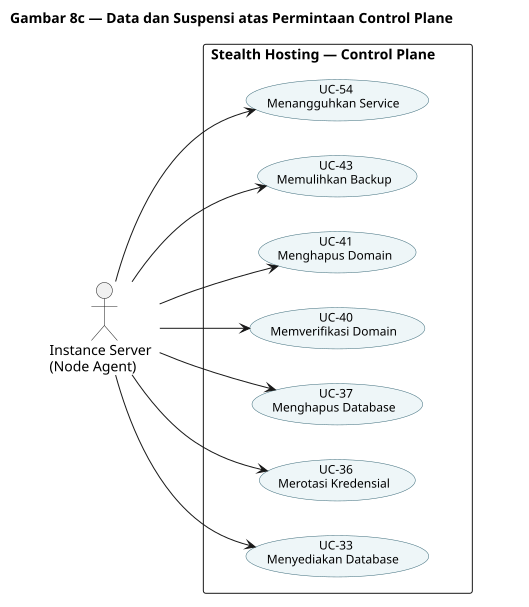

# Analisis dan Dokumentasi Use Case Diagram UML — Stealth Hosting

Dokumen ini disusun dari pembacaan langsung kode sumber proyek `app-steath`
(Control Plane Next.js, worker, Node Agent Go, dan skema `database/migrations`).
Setiap aktor, use case, dan relasi di bawah memiliki rujukan ke berkas yang
benar-benar ada di repositori. Tidak ada fitur yang dikarang.

- **Commit acuan**: `1f030bb4982e3c9c60383b2018f561905cc5aad9` (24 Nov 2026)
- **Berkas diagram**: `docs/use-case/diagrams/*.puml` (sumber PlantUML) + `*.svg`
  (hasil render, dipakai di Bagian D) + `*.png` (versi raster untuk dilihat langsung)
- **Cara render ulang**:
  - SVG: `POST https://kroki.io/plantuml/svg` dengan isi berkas `.puml`
  - PNG: `POST https://kroki.io/plantuml/png` dengan isi berkas `.puml`

---

## A. Deskripsi Sistem

### A.1 Tujuan

Stealth Hosting adalah **Platform as a Service (PaaS)** bergaya Railway: pengguna
menghubungkan sebuah repository Git, platform melakukan **Build** menjadi image
container, menjalankan container tersebut, lalu memberi alamat URL. Selain itu
platform menyediakan **managed Database**, **Volume** penyimpanan persisten,
**Custom Domain**, serta **Backup dan Restore** (`README.md`, `docs/adr/0004-paas-ala-railway.md`).

### A.2 Fungsi utama

| Kelompok fungsi | Implementasi |
|---|---|
| Autentikasi & sesi | Better Auth + sesi basis data (`lib/auth.ts`, `lib/auth-config.ts`) |
| Multi-tenancy | Organisasi sebagai tenant, peran `owner`/`admin`/`member` (`GLOSSARY.md`, `lib/platform/organization-management.ts`) |
| Resource delivery | Project → Service → Deployment (`lib/platform/projects.ts`, `services.ts`, `deployments.ts`) |
| Managed data | Database PostgreSQL 16 / MySQL 8 dengan schema+role di server bersama (`lib/platform/databases.ts`, ADR-0012) |
| Addressing | Platform Subdomain otomatis dan Custom Domain dengan verifikasi TXT+DNS (`lib/platform/custom-domains.ts`) |
| Perlindungan data | Backup harian 02.00 UTC, retensi 7 hari, Restore antrean (`lib/platform/backups.ts`, `restores.ts`) |
| Pengawasan platform | Admin Console lintas Organisasi (`app/admin/**`, `features/admin/**`) |
| Pengawasan node | Heartbeat, metrik host, operasi runtime lewat Node Agent (`agent/**`, `contracts/agent.openapi.yaml`) |

### A.3 Ruang lingkup dan batas sistem

Batas sistem pada diagram adalah **Control Plane** (aplikasi Next.js beserta
worker-nya). Empat aktor berada di luar batas itu: **Customer**, **Pengunjung
Publik**, **Platform Admin**, dan **Instance Server (Node Agent)**. Tiga yang
terakhir dijelaskan lebih rinci di Bagian B karena bukan pengguna console biasa.

> **Yang sengaja bukan aktor:** worker, scheduler, PostgreSQL, Redis, Caddy, dan
> Cloudflare Tunnel. Semuanya komponen internal atau infrastruktur pasif; mereka
> tidak punya antarmuka yang dipanggil dari luar batas sistem, sehingga tidak
> digambar sebagai stick figure.

### A.4 Stack teknis (dari `README.md` dan `package.json`)

Next.js 16 (App Router) + React 19 · Better Auth (sesi PostgreSQL) · PostgreSQL 16 ·
Tailwind CSS 4 · worker Node proses terpisah · Node Agent dalam Go · Caddy untuk
TLS/routing · Docker Compose untuk deployment satu VPS.

### A.5 Asumsi yang digunakan

Tidak ada modul bernama `InstanceServer` di repositori ini. Istilah “Instance
Server” dipetakan ke **Node Agent** karena memenuhi semua kriteria aktor
eksternal (lihat B.2). Satu-satunya kemunculan kata “Instance” di UI adalah
judul grup navigasi Admin Console yang berisi *Scan Findings* dan *Abuse Reports*
(`features/admin/components/admin-nav.ts`) — itu label menu, bukan komponen
sistem, sehingga tidak dijadikan aktor.

Asumsi lain yang dinyatakan terbuka:

1. **Satu node.** Implementasi saat ini berjalan di satu VPS dengan satu Node
   Agent; kode mendukung daftar node (`listNodes`) tetapi pemilihan node masih
   “node pertama” (`getPrimaryNode`).
2. **Kredensial OAuth belum tentu ada.** Use case autentikasi sosial tidak
   dijadikan use case tersendiri karena hanya muncul sebagai tombol
   *Coming soon* sampai admin menyimpan kredensial.
3. **Worker dianggap bagian internal Control Plane**, sehingga tidak digambar
   sebagai aktor walaupun prosesnya terpisah, karena ia tidak memiliki antarmuka
   yang dapat dipanggil dari luar dan tidak pernah berinteraksi dengan pengguna.
4. **Peran bukan aktor.** `owner`, `admin`, dan `member` adalah peran di dalam
   aktor Customer, sehingga digambarkan sebagai *precondition* pada setiap use
   case, bukan sebagai tiga stick figure.
5. **Integrasi eksternal yang belum aktif** (Resend, OTLP collector, billing)
   tidak dibuatkan use case karena belum ada implementasinya di kode.

---

## B. Identifikasi Aktor

### B.1 Customer (Member Organisasi)

- **Definisi:** User terautentikasi yang menjadi Member pada sebuah Organisasi
  (`GLOSSARY.md` — *User*, *Member*).
- **Peran:** bekerja di dalam satu Organisasi aktif dan mengelola resource milik
  Organisasi tersebut.
- **Tanggung jawab:** membuat Project/Service, menjalankan Deployment, mengatur
  Environment Variable, Volume, Database, Custom Domain, memantau kuota, serta —
  bila perannya `owner`/`admin` — mengundang dan mengatur anggota.
- **Batas wewenang (dari kode):**
  - `member`: boleh membaca seluruh resource dan **boleh memicu Deployment**
    (`app/api/services/[serviceId]/deployments/route.ts`), tetapi tidak melihat
    nilai Environment Variable atau password Database, tidak mengubah
    konfigurasi, tidak redeploy/cancel.
  - `admin` dan `owner`: boleh mengubah konfigurasi, menghapus resource,
    merotasi kredensial, memulihkan Backup.
  - Hanya `owner`: menghapus/menurunkan owner terakhir dilarang, menghapus
    Organisasi, dan menghapus anggota
    (`lib/auth-config.ts`, `app/api/organizations/**`, `app/api/organizations/members/[memberId]/route.ts`).
- **Catatan penamaan:** istilah “Customer” dipakai sebagai nama aktor karena
  itu istilah yang diminta, tetapi dokumentasi ini menuliskannya sebagai
  “Customer (Member Organisasi)” agar sesuai istilah domain proyek
  (`GLOSSARY.md` meminta menghindari kata *customer* untuk User).

### B.2 Instance Server (Node Agent) — aktor sistem eksternal

- **Definisi:** proses `stealth/agent` (Go) di hosting node
  (`agent/cmd/agent/main.go`).
- **Mengapa memenuhi kriteria aktor UML:**
  1. Berada **di luar** batas sistem Control Plane (proses, image, dan
     `Dockerfile.agent` terpisah).
  2. **Menginisiasi** interaksi: mengirim heartbeat setiap 30 detik ke
     `POST /api/nodes/heartbeat` (`agent/internal/heartbeat/sender.go`).
  3. **Menerima** permintaan dari Control Plane lewat kontrak HTTP ber-token
     (`lib/agent-client.ts`, `contracts/agent.openapi.yaml`), misalnya
     `/v1/builds`, `/v1/deployments`, `/v1/services/{id}/start|stop|restart`,
     `/v1/databases/{id}`, `/v1/backups`, `/v1/restores/{id}`.
  4. Memiliki kredensial sendiri (`AGENT_TOKEN`), bukan sesi User.
- **Kontribusi use case:** heartbeat, otorisasi sertifikat TLS on-demand, dan
  eksekusi operasi runtime yang diminta Control Plane (lihat Gambar 8a–8c).
- **Bukan aktor:** Caddy admin API (diprogram oleh Agent, bukan berinteraksi
  dengan Control Plane), Docker daemon, PostgreSQL/Redis internal.
- **Catatan batas:** Caddy sendiri memanggil `GET /api/internal/caddy/ask` untuk
  on-demand TLS. Panggilan itu dilakukan Caddy, bukan Node Agent. Pada diagram
  panggilan tersebut dikaitkan ke aktor Instance Server karena satu node
  menjalankan Agent dan Caddy sebagai satu kesatuan runtime, dan
  mengatributkannya ke aktor membuat batas sistem tetap jelas. Secara kode,
  endpoint-nya diautentikasi dengan `AGENT_TOKEN` yang sama — token milik node
  tersebut — sehingga kepemilikan aktornya konsisten.

### B.3 Pengunjung Publik

Aktor tanpa autentikasi untuk `POST /api/abuse-reports`. Berbeda dari Customer
karena tidak memiliki sesi, Organisasi, maupun wewenang apa pun di console.
Dibatasi *rate limit* per IP dan tantangan aritmetika `3 + 4`
(`lib/platform/abuse.ts`, `app/abuse-report/page.tsx`).

### B.4 Platform Admin

Aktor manusia lintas Organisasi, ditentukan oleh `PLATFORM_ADMIN_EMAILS`
(`lib/platform/platform-admin.ts`, `app/admin/layout.tsx`). Memakai **Admin
Console** (`/admin/**`) yang disalin verbatim dari stealth-forge (ADR-0008).
Tidak memakai dashboard user dan tidak membutuhkan keanggotaan Organisasi.

### B.5 Aktor yang **tidak** ditambahkan (dan alasannya)

| Kandidat | Alasan tidak dijadikan aktor |
|---|---|
| Worker / scheduler | Komponen internal Control Plane (`worker/index.mts`); tidak punya antarmuka eksternal |
| Caddy | Infrastruktur pasif; diprogram Agent lewat admin API |
| PostgreSQL, Redis | Penyimpanan internal; Redis bahkan opsional (ADR-0009) |
| GitHub/Google OAuth | Provider eksternal opsional; muncul sebagai tombol “Coming soon” bila belum dikonfigurasi, bukan aktor sistem |
| Email provider (Resend) | Belum terpasang; tautan reset hanya ditulis ke log server (`lib/auth-config.ts`) |

---

## C. Identifikasi Use Case

Legenda status: **✅ berjalan** = ada UI + API + efek nyata; **🟡 sebagian** =
jalur ada tetapi dibatasi/bergantung konfigurasi; **🚧 rencana** = belum ada.

| No | Nama Use Case | Aktor | Deskripsi aktivitas | Hasil yang diharapkan | Status |
|---|---|---|---|---|---|
| UC-01 | Mendaftar Akun | Customer | Mengisi username, email, password di `/signup` | User dibuat, Organisasi personal + Member `owner` otomatis, sesi aktif | ✅ |
| UC-02 | Masuk ke Aplikasi | Customer | Login email/password, opsi *remember* | Sesi basis data dibuat, diarahkan ke `/dashboard` | ✅ |
| UC-03 | Keluar dari Aplikasi | Customer | Menekan *Log out* | Sesi dihapus, kembali ke halaman login | ✅ |
| UC-04 | Mereset Password | Customer | `/forgot-password` → tautan `/reset-password` | Password baru tersimpan; tautan dicatat pada log server | 🟡 (belum ada email) |
| UC-05 | Membuat Organisasi | Customer | Form “Create a new organization” | Organisasi baru dengan pemohon sebagai `owner` | ✅ |
| UC-06 | Memilih Organisasi Aktif | Customer | Memilih kartu Organisasi di `/dashboard/organizations` | `session.activeOrganizationId` berganti | ✅ |
| UC-07 | Menerima Undangan Organisasi | Customer | Membuka `/invite/[id]` lalu *Accept* | Member baru masuk Organisasi dengan peran undangan | ✅ |
| UC-08 | Memperbarui Identitas Organisasi | Customer (owner) | Ubah nama/slug di `/dashboard/settings` | Nama dan slug Organisasi diperbarui + audit | ✅ |
| UC-09 | Mengundang Anggota | Customer (owner/admin) | Modal *Invite* → peran `admin`/`member` | Invitation 7 hari + URL undangan | ✅ |
| UC-10 | Mengubah Peran Anggota | Customer (owner/admin) | Pilih peran baru pada tabel anggota | Peran Member berubah (owner terakhir dilindungi) | ✅ |
| UC-11 | Menghapus Anggota | Customer (owner) | Konfirmasi hapus anggota | Member dikeluarkan dari Organisasi | ✅ |
| UC-12 | Membatalkan Undangan | Customer (owner/admin) | *Cancel* pada daftar undangan | Invitation menjadi tidak berlaku | ✅ |
| UC-13 | Keluar dari Organisasi | Customer | *Leave organization* | Keanggotaan dihapus; Organisasi aktif dialihkan | ✅ |
| UC-14 | Menghapus Organisasi | Customer (owner) | Ketik nama Organisasi lalu hapus | Organisasi, undangan, dan keanggotaan dihapus | ✅ |
| UC-15 | Memantau Penggunaan & Kuota | Customer | Buka `/dashboard/usage`, tombol *Refresh* | Snapshot CPU/RAM/Volume/DB dan status kuota terbaru | ✅ |
| UC-16 | Membuat Project | Customer (owner/admin) | Modal “New project” (nama + slug) | Project dibuat (kuota 3/Organisasi) | ✅ |
| UC-17 | Melihat Daftar Project | Customer | Halaman `/dashboard/projects` | Ringkasan Project, jumlah Service & Database | ✅ |
| UC-18 | Memperbarui Project | Customer (owner/admin) | Tab *Settings* Project → *Save Changes* | Nama/slug Project diperbarui | ✅ |
| UC-19 | Menghapus Project | Customer (owner/admin) | Ketik nama Project → *Delete Permanently* | Project beserta turunannya dihapus | ✅ |
| UC-20 | Membuat Service | Customer (owner/admin) | Modal “New Service” (repo, branch, Dockerfile, port, health path) | Service + Platform Subdomain dibuat | ✅ |
| UC-21 | Melihat Detail Service | Customer | Tab Deployments/Environment/Domains/Runtime/Settings | Status, konfigurasi, dan kebutuhan redeploy | ✅ |
| UC-22 | Menghapus Service | Customer (owner/admin) | Ketik nama Service → hapus | Service dan runtime-nya dibersihkan (best effort) | ✅ |
| UC-23 | Men-deploy Service | Customer (semua peran) | Tombol *Deploy* di tab Deployments | Deployment `queued`→`building`→`deploying`→`running` | ✅ |
| UC-24 | Men-deploy Ulang (Redeploy) | Customer (owner/admin) | *Redeploy* pada riwayat Deployment | Deployment baru yang membangun commit yang sama | ✅ |
| UC-25 | Membatalkan Deployment | Customer (owner/admin) | *Cancel* saat Deployment aktif | Build dihentikan, container/image sisa dibersihkan | ✅ |
| UC-26 | Melihat Riwayat & Log Build | Customer | Buka riwayat lalu lihat log | Riwayat Deployment dan log Build (retensi 7 hari) | ✅ |
| UC-27 | Menghentikan Service | Customer (owner/admin) | *Stop* di tab Runtime | Container berhenti, hostname berhenti menjawab | ✅ |
| UC-28 | Menjalankan Service | Customer (owner/admin) | *Start* | Container yang sama hidup kembali (data layer tetap) | ✅ |
| UC-29 | Me-restart Service | Customer (owner/admin) | *Restart* | Container dijalankan ulang tanpa mengubah konfigurasi | ✅ |
| UC-30 | Melihat Log Runtime | Customer | Buka panel log | Log container mengalir (tail 200, buffer 500 baris) | ✅ |
| UC-31 | Mengelola Environment Variable | Customer (owner/admin) | Tambah/Ubah/Hapus, *Reveal* nilai | Variabel tersimpan terenkripsi; Service ditandai perlu redeploy | ✅ |
| UC-32 | Mengelola Volume | Customer (owner/admin) | Tambah Volume (mount path, ukuran) / hapus | Volume Docker disiapkan pada Deployment berikutnya; hapus meminta Agent | ✅ |
| UC-33 | Menyediakan Database | Customer (owner/admin) | Pilih engine (PostgreSQL/MySQL) → *Provision* | Schema + role di server bersama dibuat Agent; kredensial disegel | ✅ |
| UC-34 | Melihat Detail Database | Customer | Tab Database pada Project | Engine, versi, pemakaian storage, status phpMyAdmin | ✅ |
| UC-35 | Menampilkan Password Database | Customer (owner/admin) | Tombol *Reveal* / salin | Password dikembalikan sesuai permintaan + audit (bukan di HTML) | ✅ |
| UC-36 | Merotasi Kredensial Database | Customer (owner/admin) | *Rotate Password* | Password role diganti Agent; Service perlu redeploy | ✅ |
| UC-37 | Menghapus Database | Customer (owner/admin) | Ketik nama Project → hapus | Schema+role dihapus Agent, lalu baris Database | ✅ |
| UC-38 | Membuka phpMyAdmin | Customer (owner/admin, MySQL) | *Open phpMyAdmin* | Token SSO 60 detik sekali pakai → sesi phpMyAdmin | ✅ (MySQL) |
| UC-39 | Menambahkan Custom Domain | Customer (owner/admin) | Tambah hostname ke Service | Domain `pending` + instruksi TXT/CNAME | ✅ |
| UC-40 | Memverifikasi Custom Domain | Customer (owner/admin) | *Verify* | DNS/TXT cocok → route dipasang, sertifikat `issued` | ✅ |
| UC-41 | Menghapus Custom Domain | Customer (owner/admin) | Hapus pada daftar Domain | Route dan status sertifikat dibersihkan | ✅ |
| UC-42 | Melihat Daftar Backup | Customer | `/dashboard/backups` | Daftar Backup Database/Volume/platform + status | ✅ |
| UC-43 | Memulihkan Backup | Customer (owner/admin) | Ketik nama target → *Restore* | Restore diantrekan; Service terkait dihentikan lalu dinyalakan | ✅ |
| UC-44 | Melihat Status Restore | Customer | Panel restore | Status `pending`/`running`/`completed`/`failed` | ✅ |
| UC-45 | Melaporkan Konten Abuse | Pengunjung Publik | Form `/abuse-report` | Laporan tersimpan dengan status `new` | ✅ |
| UC-46 | Melihat Overview Platform | Platform Admin | Halaman `/admin` | Kesehatan komponen, jumlah operasi, Deployment terbaru | ✅ |
| UC-47 | Memantau Infrastruktur | Platform Admin | `/admin/infrastructure` | Daftar node, worker, dan grafik resource | ✅ |
| UC-48 | Menelusuri Log, Trace & Error | Platform Admin | `/admin/logs`, `/admin/traces`, `/admin/errors` | Tail log Build, daftar error group; trace masih kosong | 🟡 (trace kosong) |
| UC-49 | Melihat Antrean & Agent Run | Platform Admin | `/admin/workers`, `/admin/runs`, `/admin/usage` | Daftar job/operasi durable dan ringkasan beban kerja control-plane | ✅ |
| UC-50 | Mengelola Insiden | Platform Admin | `/admin/incidents` | Buat insiden, ubah status, tambah event | ✅ |
| UC-51 | Melihat Daftar Akun | Platform Admin | `/admin/users` | Daftar akun, status verifikasi, provider, sign-in terakhir | ✅ |
| UC-52 | Meninjau Scan Findings | Platform Admin | `/admin/findings` | Temuan Trivy/ClamAV per Deployment | ✅ |
| UC-53 | Menangani Abuse Report | Platform Admin | `/admin/abuse-reports` | Status laporan `new`→`triaged`→`resolved`/`dismissed` | ✅ |
| UC-54 | Menangguhkan Service/Organisasi | Platform Admin | Aksi suspend/unsuspend | Service dihentikan dan menjawab 503 administratif | ✅ |
| UC-55 | Mengatur Provider Sign-in & Status Page | Platform Admin | `/admin/settings`, `/admin/providers`, `/admin/status` | Kredensial OAuth tersimpan (berlaku setelah restart); status page | 🟡 (sebagian form lokal) |
| UC-56 | Mengirim Heartbeat Node | Instance Server | Kirim berkala tiap 30 detik | `node.lastSeenAt`/`capacity` diperbarui; Deployment diblokir bila tidak sehat | ✅ |
| UC-57 | Meminta Otorisasi Sertifikat TLS | Instance Server | Caddy memanggil `GET /api/internal/caddy/ask` | Jawaban `allowed` hanya untuk hostname sah | ✅ |

### C.1 Ringkasan status fitur

**Sudah berjalan (utama):** autentikasi, organisasi & peran, Project, Service,
Deployment (trigger/redeploy/cancel/log), runtime start/stop/restart/log,
Environment Variable + reveal, Volume, Database dua engine, password reveal,
rotasi, hapus, phpMyAdmin SSO (MySQL), Custom Domain + verifikasi, Backup &
Restore, kuota, abuse report publik, seluruh panel Admin Console, heartbeat dan
otorisasi TLS.

**Sudah dibuat tetapi belum selesai / bergantung konfigurasi:**

| Fitur | Kondisi sebenarnya | Dasar |
|---|---|---|
| Reset password | Tautan hanya ditulis ke log server; belum ada pengiriman email | `lib/auth-config.ts` (`sendResetPassword`) |
| Verifikasi email | `requireEmailVerification: false` | `lib/auth-config.ts` |
| OAuth Google/GitHub | Tombol *Coming soon* sampai kredensial disimpan admin | `components/auth-form.tsx`, `lib/platform/oauth-providers.ts` |
| phpMyAdmin | Hanya Database MySQL; PostgreSQL tidak punya jalur ini | `lib/platform/databases.ts`, `app/api/phpmyadmin/sso/route.ts` |
| Public Database Proxy | **Sengaja dinonaktifkan**; selalu `409 database_proxy_unsupported` | `lib/platform/databases.ts`, ADR-0012 |
| Traces | Endpoint menjawab daftar kosong (belum ada kolektor OTLP) | `app/api/admin/telemetry/traces/route.ts` |
| Status error group | Perubahan status divalidasi lalu diakui, belum dipersist | `app/api/admin/telemetry/errors/[fingerprint]/status/route.ts` |
| Plan langganan | Selalu `free`; perubahan plan diakui tanpa kolom plan | `app/api/admin/accounts/[accountID]/plan/route.ts` |
| Form Settings admin | Sebagian switch/field hanya state lokal | `features/admin/settings/settings-page.tsx` |
| Agent catalog / eksekusi agent | Katalog kosong, `ready:false` | `app/api/admin/agent-catalog/route.ts` |

**Masih berupa rencana:** email transaksional (Resend), OAuth aktif tanpa
konfigurasi, billing/plan berbayar, kolektor telemetri (log/trace OTLP),
auto-deploy lewat webhook Git (tidak ditemukan kode webhook), profil/avatar,
dan Redis sebagai cache wajib (opsional per ADR-0009).

---

## D. Use Case Diagram

Sepuluh diagram berikut membagi sistem per modul agar tidak padat. Semua berada
di `docs/use-case/diagrams/`.

**Aturan pemetaan aktor Instance Server pada diagram.** Node Agent hanya
diasosiasikan dengan use case yang **pekerjaan utamanya dijalankan di node** —
build/deploy, hapus Service beserta container & route-nya, stop/start/restart,
stream log container, Volume, schema Database, verifikasi/hapus Custom Domain,
Restore, dan suspensi. Use case yang datanya **dibaca dari PostgreSQL milik
Control Plane** (UC-26 riwayat & log Build, UC-34 detail Database, UC-42 daftar
Backup, UC-44 status Restore) tidak diasosiasikan dengan Node Agent walaupun
datanya pernah berasal dari Agent. UC-31 (Environment Variable) juga tidak:
nilainya baru dikirim ke Agent sebagai bagian dari UC-23. UC-15 (Penggunaan &
Kuota) hanya membaca metrik pasif `GET /v1/usage` yang kegagalannya ditoleransi,
sehingga tidak digambar sebagai interaksi dengan aktor.

### Gambar 1 — Peta Aktor dan Modul Sistem

Menunjukkan empat aktor dan pengelompokan 57 use case ke delapan modul. Berguna
sebagai peta navigasi sebelum membaca diagram rinci: modul 1–5 untuk Customer,
modul 6 untuk Pengunjung Publik, modul 7 untuk Platform Admin, dan modul 8 untuk
Instance Server. Instance Server juga menarik garis ke modul 3, 4, 5, dan 7
karena sebagian use case di sana mengubah keadaan di node (lihat Gambar 8b–8c).

### Gambar 2 — Autentikasi dan Onboarding

### Gambar 3 — Organisasi, Tim, dan Kuota

### Gambar 4 — Project dan Service

### Gambar 5 — Deployment dan Runtime Service

### Gambar 6 — Database, Custom Domain, dan Backup

### Gambar 7 — Layanan Publik dan Admin Console

### Gambar 8a — Use Case yang Dipicu Sendiri oleh Node Agent

Dua use case ini berasal dari Instance Server: Node Agent mengirim heartbeat
setiap 30 detik dan Caddy meminta otorisasi sertifikat TLS on-demand. Panahnya
`IS --> use case`, artinya Node Agent adalah aktor di luar batas sistem yang
berinteraksi dengan fungsi sistem, bukan bagian dari sistem.

### Gambar 8b — Operasi Runtime atas Permintaan Control Plane

Operasi yang mengubah container atau route: deploy/redeploy/cancel, hapus
Service, stop/start/restart, log runtime, dan Volume. Use case-nya sama dengan
Gambar 4 dan 5, tetapi di sini yang digambar adalah sisi aktor sistemnya.

### Gambar 8c — Data dan Suspensi atas Permintaan Control Plane

Operasi yang menyentuh data atau trafik publik: provision/rotate/hapus Database,
verifikasi dan hapus Custom Domain, Restore Backup, serta suspensi Service.
Sebagian use case ini juga muncul di Gambar 6 dan 7.

---

## E. Deskripsi Setiap Use Case

Format: **Aktor · Tujuan · Prasyarat · Alur utama · Alur alternatif · Kondisi akhir.**
Karena jumlahnya 57, use case dengan pola serupa dikelompokkan dalam satu blok
tetapi tetap dijelaskan satu per satu.

### E.1 Modul Autentikasi dan Onboarding

#### UC-01 Mendaftar Akun
- **Aktor:** Customer (belum terautentikasi)
- **Tujuan:** membuat akun dan ruang kerja pertama.
- **Prasyarat:** belum ada sesi; username, email, password valid.
- **Alur utama:** buka `/signup` → isi username/email/password → `signUp.email` →
  trigger `platform_create_personal_organization` membuat Organisasi personal →
  Member `owner` dibuat → sesi dibuat → diarahkan ke dashboard.
- **Alur alternatif:** email/username sudah dipakai → pesan error, akun tidak dibuat.
- **Kondisi akhir:** User, Organisasi personal, dan Member `owner` ada; sesi aktif.

#### UC-02 Masuk ke Aplikasi
- **Aktor:** Customer
- **Tujuan:** memperoleh sesi.
- **Prasyarat:** akun terdaftar.
- **Alur utama:** `/login` → email+password → Better Auth memverifikasi → sesi
  basis data dibuat (30 hari, refresh harian) → `/dashboard`.
- **Alur alternatif:** kredensial salah → error tanpa sesi; provider OAuth belum
  dikonfigurasi → tombol *Coming soon*.
- **Kondisi akhir:** sesi aktif dengan `activeOrganizationId` bila ada.

#### UC-03 Keluar dari Aplikasi
- **Aktor:** Customer · **Prasyarat:** sesi aktif.
- **Alur utama:** menu pengguna → *Log out* → `signOut` → sesi dihapus → `/`.
- **Kondisi akhir:** tidak ada sesi.

#### UC-04 Mereset Password
- **Aktor:** Customer · **Prasyarat:** akun dengan email.
- **Alur utama:** `/forgot-password` → Better Auth membuat token & URL →
  `sendResetPassword` menulis tautan ke log server + audit → pengguna membuka
  `/reset-password` → password baru disimpan.
- **Alur alternatif:** layanan email belum ada sehingga tautan harus diambil dari
  log administrator.
- **Kondisi akhir:** password baru berlaku; tautan kedaluwarsa 1 jam.

#### UC-05 Membuat Organisasi
- **Aktor:** Customer · **Prasyarat:** sesi aktif.
- **Alur utama:** `/dashboard/organizations` → *Create organization* → isi nama →
  `organization.create` dengan slug unik → Organisasi muncul.
- **Alur alternatif:** nama menghasilkan slug kosong → validasi menolak.
- **Kondisi akhir:** Organisasi baru dengan pemohon sebagai `owner`.

#### UC-06 Memilih Organisasi Aktif
- **Aktor:** Customer · **Prasyarat:** menjadi Member minimal satu Organisasi.
- **Alur utama:** pilih kartu Organisasi → `setActive` → `activeOrganizationId`
  berubah → `router.refresh`.
- **Alur alternatif:** tidak ada Organisasi → dashboard menampilkan onboarding.
- **Kondisi akhir:** seluruh data dashboard mengikuti Organisasi aktif.

#### UC-07 Menerima Undangan Organisasi
- **Aktor:** Customer · **Prasyarat:** sesi aktif dan invitation `pending`.
- **Alur utama:** buka `/invite/[id]` → `getInvitation` menampilkan nama
  Organisasi dan peran → *Accept* → Member dibuat → audit `member.joined`.
- **Alur alternatif:** belum login → diarahkan ke login dengan `returnTo`;
  invitation kedaluwarsa → pesan “invalid or expired”.
- **Kondisi akhir:** keanggotaan baru aktif.

### E.2 Modul Organisasi, Tim, dan Kuota

#### UC-08 Memperbarui Identitas Organisasi
- **Aktor:** Customer (`owner`) · **Prasyarat:** Organisasi aktif, peran owner.
- **Alur utama:** `/dashboard/settings` → ubah nama → *Save* →
  `organization.update` → audit `organization.updated`.
- **Alur alternatif:** slug bentrok/format salah → pesan error.
- **Kondisi akhir:** nama/slug baru tersimpan.

#### UC-09 Mengundang Anggota
- **Aktor:** Customer (`owner`/`admin`) · **Prasyarat:** peran memadai.
- **Alur utama:** tab Team → *Invite* → email + peran → `inviteMember` →
  tautan `/invite/<id>` berlaku 7 hari.
- **Alur alternatif:** email sudah menjadi Member Organisasi → ditolak.
- **Kondisi akhir:** Invitation `pending` dan dapat dibagikan.

#### UC-10 Mengubah Peran Anggota
- **Aktor:** Customer (`owner`/`admin`) · **Prasyarat:** target adalah Member.
- **Alur utama:** ubah pilihan peran → `PATCH /api/organizations/members/[id]` →
  hanya `admin`/`member` diterima.
- **Alur alternatif:** menurunkan owner terakhir → hook `beforeUpdateMemberRole`
  menolak.
- **Kondisi akhir:** peran tersimpan + audit.

#### UC-11 Menghapus Anggota
- **Aktor:** Customer (`owner`) · **Prasyarat:** peran owner.
- **Alur utama:** *Remove* → konfirmasi → `DELETE /api/organizations/members/[id]`.
- **Alur alternatif:** owner terakhir → `beforeRemoveMember` menolak.
- **Kondisi akhir:** Member keluar dari Organisasi.

#### UC-12 Membatalkan Undangan
- **Aktor:** Customer (`owner`/`admin`) · **Prasyarat:** ada undangan `pending`.
- **Alur utama:** *Cancel* → `cancelInvitation` → audit `invitation.cancelled`.
- **Kondisi akhir:** tautan undangan tidak berlaku.

#### UC-13 Keluar dari Organisasi
- **Aktor:** Customer · **Prasyarat:** Member (bukan owner tunggal).
- **Alur utama:** *Leave* → `POST /api/organizations/leave` →
  `leaveOrganization` → audit `member.left` → Organisasi aktif dialihkan.
- **Alur alternatif:** owner terakhir → ditolak.
- **Kondisi akhir:** keanggotaan hilang.

#### UC-14 Menghapus Organisasi
- **Aktor:** Customer (`owner`) · **Prasyarat:** owner, nama Organisasi diketahui.
- **Alur utama:** *Danger zone* → ketik nama → konfirmasi →
  `deleteOrganizationWithConfirmation` → sesi/undangan/anggota/organisasi dihapus
  dalam satu transaksi.
- **Alur alternatif:** teks konfirmasi tidak sama → transaksi dibatalkan.
- **Kondisi akhir:** Organisasi hilang; pengguna masuk alur onboarding.

#### UC-15 Memantau Penggunaan & Kuota
- **Aktor:** Customer · **Prasyarat:** Organisasi aktif.
- **Alur utama:** buka `/dashboard/usage` → `GET /api/usage` memaksa
  `refreshOrganizationUsage` (membaca `GET /v1/usage` dari Agent sekali untuk
  seluruh node) → menampilkan CPU, RAM, Volume, Database, dan kuota (3 Project,
  5 Service, 2 Service/Project, 1 Database/Project, 0.5 vCPU, 512 MB, 1 GB
  Volume, 1 GB Database, retensi log 7 hari). Worker juga menyegarkan semua
  Organisasi setiap 5 menit.
- **Alur alternatif:** node tidak sehat/tidak terjangkau → `loadAgentUsage`
  mencatat error dan mengembalikan `null`, sehingga snapshot terakhir tetap
  ditampilkan tanpa menggagalkan halaman.
- **Kondisi akhir:** snapshot terbaru tercatat.

### E.3 Modul Project dan Service

#### UC-16 Membuat Project
- **Aktor:** Customer (`owner`/`admin`) · **Prasyarat:** sesi, kuota Project < 3.
- **Alur utama:** `/dashboard/projects` → *New project* → nama (+slug) →
  `createProject` → audit `project.created`.
- **Alur alternatif:** kuota penuh → `409 quota_exceeded`; slug tidak valid →
  `400`.
- **Kondisi akhir:** Project `empty` muncul di daftar.

#### UC-17 Melihat Daftar Project
- **Aktor:** Customer · **Prasyarat:** Organisasi aktif.
- **Alur utama:** halaman memuat `listProjects` → kartu Project dengan jumlah
  Service/Database dan engine.
- **Kondisi akhir:** data terbaca; tidak ada perubahan.

#### UC-18 Memperbarui Project
- **Aktor:** Customer (`owner`/`admin`) · **Prasyarat:** Project ada.
- **Alur utama:** tab *Settings* → ubah nama/slug → *Save Changes* →
  `PATCH /api/projects/[id]` → audit `project.updated`.
- **Alur alternatif:** slug bentrok/format salah → error, data lama tetap.
- **Kondisi akhir:** Project diperbarui.

#### UC-19 Menghapus Project
- **Aktor:** Customer (`owner`/`admin`) · **Prasyarat:** nama Project diketahui.
- **Alur utama:** ketik nama → *Delete Permanently* → `deleteProject` → audit
  `project.deleted`.
- **Alur alternatif:** teks tidak sama → `confirmation_mismatch`.
- **Catatan runtime:** baris Service/Database/Volume/Domain ikut terhapus lewat
  `ON DELETE CASCADE`, tetapi container dan route-nya **tidak** dihapus pada
  request ini. Instance Server membersihkannya saat *Cleanup*/`reconcile`
  (container kandidat sisa, image lama, Volume yatim, route yang upstream-nya
  sudah hilang), sehingga node kembali rapi tanpa menunggu Control Plane.
- **Kondisi akhir:** Project dan turunannya dihapus; sisa runtime dibersihkan
  Agent pada siklus berikutnya.

#### UC-20 Membuat Service
- **Aktor:** Customer (`owner`/`admin`) · **Prasyarat:** Project ada, kuota Service
  (2/Project, 5/Organisasi) tersedia.
- **Alur utama:** *New Service* → URL repo HTTPS, branch, Dockerfile, port,
  health path → `createService` → Platform Subdomain unik dibuat → audit.
- **Alur alternatif:** repo bukan HTTPS/berisi kredensial → ditolak; bentrok
  hostname → dicoba ulang dengan id pendek baru.
- **Kondisi akhir:** Service `not_deployed` siap di-deploy.

#### UC-21 Melihat Detail Service
- **Aktor:** Customer · **Prasyarat:** Service milik Organisasi.
- **Alur utama:** buka `/dashboard/services/[id]` → tab Deployments, Environment,
  Domains, Runtime, Settings; penanda `needsRedeploy` bila konfigurasi berubah.
- **Kondisi akhir:** informasi terbaca.

#### UC-22 Menghapus Service
- **Aktor:** Customer (`owner`/`admin`), Instance Server
- **Prasyarat:** nama Service diketahui.
- **Alur utama:** ketik nama → hapus → baris Service dihapus → Control Plane
  meminta Agent menghapus container & route (best effort).
- **Alur alternatif:** Agent tidak terjangkau → penghapusan tetap berhasil, sisa
  runtime dicatat di log.
- **Kondisi akhir:** Service hilang dari daftar.

### E.4 Modul Deployment dan Runtime

#### UC-23 Men-deploy Service
- **Aktor:** Customer (semua peran), Instance Server
- **Prasyarat:** node sehat (heartbeat segar), tidak ada Deployment aktif, Service
  tidak `suspended`.
- **Alur utama:** *Deploy* → `triggerDeployment` membuat Deployment `queued` +
  Build Job → worker mengklaim job → memanggil Agent `/v1/builds` → log Build
  dialirkan → Agent `/v1/deployments` menjalankan container kandidat, health
  check, lalu memindahkan route → Deployment `running`; scan image diantrekan.
- **Alur alternatif:** (a) node tidak sehat → `409 node_unhealthy`; (b) sudah ada
  Deployment aktif → `409 deployment_in_progress`; (c) build/health gagal →
  Deployment `failed`, container lama tetap melayani.
- **Kondisi akhir:** versi baru melayani Platform Subdomain, atau versi lama tetap
  jalan dengan catatan kegagalan.

#### UC-24 Men-deploy Ulang (Redeploy)
- **Aktor:** Customer (`owner`/`admin`), Instance Server
- **Prasyarat:** ada Deployment lampau.
- **Alur utama:** pilih Deployment → *Redeploy* → `redeployDeployment` membuat
  Deployment baru untuk commit yang sama → bila Build Job diantrekan, alur
  UC-23 berjalan.
- **Alur alternatif:** commit tidak lagi dapat diambil → Build `failed`.
- **Kondisi akhir:** Deployment baru dengan commit terpin.

#### UC-25 Membatalkan Deployment
- **Aktor:** Customer (`owner`/`admin`), Instance Server
- **Prasyarat:** Deployment `queued`/`building`.
- **Alur utama:** *Cancel* → `cancelDeployment` → Agent
  `/v1/deployments/{id}/cancel` menghentikan build dan membersihkan container
  serta image sisa; route Service yang sudah melayani tidak disentuh.
- **Alur alternatif:** (a) status sudah `deploying`/`running`/`failed`/
  `cancelled` → `409 deployment_not_cancellable`; (b) Agent tidak terjangkau →
  Deployment tetap ditandai `cancelled` (agar worker tidak membangunnya), sisa
  container dibersihkan pada *startup Cleanup* Agent.
- **Kondisi akhir:** Deployment `cancelled`; Service kembali `running` bila ada
  Deployment lama yang masih melayani, atau `not_deployed` bila ini percobaan
  pertama.

#### UC-26 Melihat Riwayat & Log Build
- **Aktor:** Customer · **Prasyarat:** ada riwayat Deployment.
- **Alur utama:** panel Deployments memuat riwayat dan log Build (NDJSON) yang
  disimpan hingga 7 hari.
- **Kondisi akhir:** riwayat dan log terbaca.

#### UC-27 Menghentikan Service
- **Aktor:** Customer (`owner`/`admin`), Instance Server
- **Alur utama:** *Stop* → Control Plane memanggil Agent
  `/v1/services/{id}/stop` → status Service disalin dari Agent (`stopped`) dan
  route berhenti menjawab; container tidak dihapus.
- **Alur alternatif:** (a) belum ada container → `409 service_not_running`;
  (b) Agent gagal/lima-ratus → `502 agent_unavailable`, status Service tidak
  berubah.
- **Kondisi akhir:** container berhenti tanpa dihapus.

#### UC-28 Menjalankan Service
- **Aktor:** Customer (`owner`/`admin`), Instance Server
- **Alur utama:** *Start* → Agent `/start` → container yang sama hidup lagi →
  status Service disalin (`running`).
- **Alur alternatif:** belum ada container → `409 service_not_running`.
- **Kondisi akhir:** status `running`.

#### UC-29 Me-restart Service
- **Aktor:** Customer (`owner`/`admin`), Instance Server
- **Alur utama:** *Restart* → Agent `/restart` → konfigurasi tidak berubah.
- **Alur alternatif:** belum ada container → `409 service_not_running`.
- **Kondisi akhir:** container dijalankan ulang.

#### UC-30 Melihat Log Runtime
- **Aktor:** Customer, Instance Server
- **Alur utama:** buka panel log → Control Plane meneruskan `GET` ke Agent
  `/v1/services/{id}/logs?tail=200` (dibatasi maksimum `1000`) → Agent
  mengalirkan baris container sebagai NDJSON (`Content-Type:
  application/x-ndjson`, `Cache-Control: no-store`) dengan timestamp asli
  container → panel menyimpan hingga 500 baris; stream ditutup saat panel
  ditutup.
- **Alur alternatif:** Service belum punya container → `409 service_not_running`
  (diperiksa sebelum stream dibuka, agar dashboard tidak menunggu stream kosong).
- **Kondisi akhir:** tidak ada perubahan state.

#### UC-31 Mengelola Environment Variable
- **Aktor:** Customer (`owner`/`admin`)
- **Prasyarat:** Service ada; `ENV_ENCRYPTION_KEY` terpasang untuk penyimpanan.
- **Catatan aktor:** Instance Server hanya menerima nilai variabel sebagai bagian
  dari Deployment berikutnya (UC-23), sehingga tidak berasosiasi langsung dengan
  use case ini.
- **Alur utama:** tambah/ubah variabel → nilai disegel (AES) → audit mencatat
  *key* tanpa nilai → revisi Service naik (`needsRedeploy`). *Reveal* memakai
  `POST .../reveal` (owner/admin) dan selalu `no-store`.
- **Alur alternatif:** kunci enkripsi tidak diset → `503 encryption_not_configured`;
  peran `member` → 403.
- **Kondisi akhir:** variabel tersimpan; nilai baru berlaku setelah Deployment.

#### UC-32 Mengelola Volume
- **Aktor:** Customer (`owner`/`admin`), Instance Server
- **Prasyarat:** Service belum punya Volume (maksimal satu).
- **Alur utama:** tambah Volume (mount path absolut, `sizeMb` 1–1024) → revisi
  Service naik (`needsRedeploy`) → Agent membuat Volume saat Deployment; hapus →
  Control Plane meminta Agent menghapus Volume lebih dulu.
- **Alur alternatif:** Volume sudah ada → `409 volume_exists`; ukuran di luar
  1–1024 MB atau mount path relatif → `422 validation_error`; Service masih
  berjalan → Agent menjawab `409` dan Control Plane meneruskannya sebagai
  `409 volume_in_use` (“Stop the Service before deleting its Volume”); Agent
  gagal → `502 volume_removal_failed` dan baris dipertahankan agar dapat
  diulang.
- **Kondisi akhir:** Volume terpasang/terhapus.

### E.5 Modul Database, Domain, dan Backup

#### UC-33 Menyediakan Database
- **Aktor:** Customer (`owner`/`admin`), Instance Server
- **Prasyarat:** Project belum punya Database; kuota 1 Database/Project.
- **Alur utama:** pilih engine (PostgreSQL 16 default / MySQL 8) → *Provision* →
  Control Plane menyegel password → Agent membuat schema+role di server bersama →
  baris Database tersimpan → audit.
- **Alur alternatif:** Agent gagal → `502 database_provisioning_failed`, baris
  dibatalkan.
- **Kondisi akhir:** Database berstatus `running`; Service satu Project mendapat
  `DATABASE_URL`.

#### UC-34 Melihat Detail Database
- **Aktor:** Customer · **Prasyarat:** Database ada.
- **Alur utama:** tab Database menampilkan engine, versi, storage terpakai/limit,
  hostname privat, status phpMyAdmin (MySQL). Anggota `member` tidak menerima
  connection string.
- **Kondisi akhir:** informasi terbaca.

#### UC-35 Menampilkan Password Database
- **Aktor:** Customer (`owner`/`admin`) · **Prasyarat:** Database ada.
- **Alur utama:** *Reveal* → `GET .../database/password` → password didekripsi →
  audit `database.password_revealed` (nilai tidak dicatat).
- **Alur alternatif:** peran member → 403.
- **Kondisi akhir:** password tampil sementara di klien.

#### UC-36 Merotasi Kredensial Database
- **Aktor:** Customer (`owner`/`admin`), Instance Server
- **Alur utama:** *Rotate Password* → buat password acak → Agent
  `/v1/databases/{id}/rotate` → nilai tersegel diganti → audit.
- **Alur alternatif:** Database tidak berjalan → `409 database_not_running`.
- **Kondisi akhir:** password lama tidak berlaku; Service perlu redeploy.

#### UC-37 Menghapus Database
- **Aktor:** Customer (`owner`/`admin`), Instance Server
- **Prasyarat:** nama Project diketahui.
- **Alur utama:** ketik nama Project → hapus → Agent menghapus schema+role →
  baris dihapus → revisi Project naik.
- **Alur alternatif:** Agent gagal → `502 database_removal_failed`, data tidak
  dihapus.
- **Kondisi akhir:** Database hilang; `DATABASE_URL` dihapus pada deploy berikutnya.

#### UC-38 Membuka phpMyAdmin
- **Aktor:** Customer (`owner`/`admin`, MySQL)
- **Prasyarat:** engine MySQL, `phpMyAdmin.enabled` benar untuk Database tersebut.
- **Alur utama:** *Open phpMyAdmin* → `POST .../database/phpmyadmin` menerbitkan
  token bertanda tangan 60 detik sekali pakai dan mengembalikan
  `https://<pma-host>/_sso?token=…` → Control Plane memverifikasi token, membaca
  kredensial tenant, login ke phpMyAdmin di sisi server → cookie `__Secure-*`
  milik phpMyAdmin diteruskan ke browser → browser masuk ke UI.
- **Alur alternatif:** token kedaluwarsa/sudah dipakai → halaman gagal; engine
  PostgreSQL → `409 phpmyadmin_unsupported`.
- **Kondisi akhir:** sesi phpMyAdmin aktif tanpa password pernah menyentuh
  browser; password tidak pernah dikirim ke klien.

#### UC-39 Menambahkan Custom Domain
- **Aktor:** Customer (`owner`/`admin`) · **Prasyarat:** Service ada.
- **Alur utama:** tambah hostname → baris `pending` + token verifikasi + instruksi
  TXT/CNAME.
- **Alur alternatif:** Service sudah punya Custom Domain → `409 custom_domain_exists`
  (satu domain per Service, ditegakkan `UNIQUE "serviceId"`).
- **Kondisi akhir:** domain `pending`.

#### UC-40 Memverifikasi Custom Domain
- **Aktor:** Customer (`owner`/`admin`), Instance Server
- **Prasyarat:** record TXT sudah dipublikasikan, Service berjalan.
- **Alur utama:** *Verify* → cek TXT `_stealth-verify.<host>` dan resolusi DNS →
  Agent `PUT /v1/services/{id}/hostnames/{host}` → status `active`, sertifikat
  `issued`.
- **Alur alternatif:** TXT/DNS salah → status `failed` + alasan (HTTP 200, bukan
  500); Service belum berjalan → `409 service_not_running`.
- **Kondisi akhir:** domain melayani trafik dengan TLS.

#### UC-41 Menghapus Custom Domain
- **Aktor:** Customer (`owner`/`admin`)
- **Alur utama:** hapus → Control Plane meminta Agent menghapus route lebih dulu
  → baris hilang → audit.
- **Alur alternatif:** Agent gagal → penghapusan dibatalkan agar route tidak
  menggantung.
- **Kondisi akhir:** domain tidak lagi diarahkan.

#### UC-42 Melihat Daftar Backup
- **Aktor:** Customer · **Prasyarat:** Organisasi aktif.
- **Alur utama:** buka `/dashboard/backups` → daftar Backup Database, Volume, dan
  platform + status + masa berlaku (7 hari) + jenis storage.
- **Kondisi akhir:** informasi terbaca.

#### UC-43 Memulihkan Backup
- **Aktor:** Customer (`owner`/`admin`), Instance Server
- **Prasyarat:** Backup `completed`, artifact tersedia, target bukan `platform`.
- **Alur utama:** *Restore* → ketik nama target → `createRestore` membuat Restore
  + Job → worker: hentikan Service terkait → Agent `/v1/restores/{id}` →
  nyalakan kembali.
- **Alur alternatif:** nama salah → `confirmation_mismatch`; backup platform →
  `backup_not_restorable`; backup belum selesai → `409`.
- **Kondisi akhir:** data dipulihkan; Service kembali berjalan.

#### UC-44 Melihat Status Restore
- **Aktor:** Customer · **Prasyarat:** ada Restore.
- **Alur utama:** panel menampilkan `pending`/`running`/`completed`/`failed` dan
  pesan kegagalan.
- **Kondisi akhir:** status terbaca.

### E.6 Layanan Publik

#### UC-45 Melaporkan Konten Abuse
- **Aktor:** Pengunjung Publik · **Prasyarat:** tidak perlu sesi.
- **Alur utama:** `/abuse-report` → URL target (maks. 2048 karakter), kategori
  (`malware`/`phishing`/`spam`/`copyright`/`other`), deskripsi (maks. 5000
  karakter), email opsional, jawaban `3 + 4` → `POST /api/abuse-reports` →
  laporan `new`.
- **Alur alternatif:** (a) jawaban bukan `7` → `400 challenge_failed`;
  (b) URL/kategori/deskripsi tidak valid → `400 invalid_report`;
  (c) melewati batas **tiga laporan per jam per IP** (jendela bergulir) →
  `429 rate_limited` (`lib/platform/abuse.ts`).
- **Kondisi akhir:** laporan masuk antrean admin.

### E.7 Admin Console (Platform Admin)

#### UC-46 Melihat Overview Platform
- **Aktor:** Platform Admin · **Prasyarat:** email terdaftar admin.
- **Alur utama:** `/admin` → kesehatan api/postgres/redis/agent, jumlah operasi,
  Deployment terbaru lintas Project.
- **Kondisi akhir:** ringkasan terbaca.

#### UC-47 Memantau Infrastruktur
- **Aktor:** Platform Admin
- **Alur utama:** `/admin/infrastructure` menampilkan node, worker, dan grafik
  resource dari sampel metrik host.
- **Kondisi akhir:** informasi terbaca.

#### UC-48 Menelusuri Log, Trace & Error
- **Aktor:** Platform Admin
- **Alur utama:** `/admin/logs` membaca tail `build_log` lewat
  `GET /api/admin/telemetry/logs` (filter `from`/`to`/`service`/`query`/level,
  `limit` bawaan 250 dan maksimum 1000; level diturunkan dari teks karena
  `build_log` tidak punya kolom level); `/admin/errors` mengelompokkan kegagalan
  Deployment/Job per fingerprint; `/admin/traces` menjawab daftar kosong.
- **Alur alternatif:** belum ada kolektor OTLP → halaman trace menampilkan empty
  state.
- **Kondisi akhir:** informasi terbaca; perubahan status error group divalidasi
  tetapi belum tersimpan.

#### UC-49 Melihat Antrean & Agent Run
- **Aktor:** Platform Admin · **Alur utama:** `/admin/workers` (Execution Queue) dan
  `/admin/runs` (Agent Runs) menampilkan job/operasi durable lintas Organisasi
  dengan filter waktu; `/admin/usage` merangkum beban kerja control-plane
  (Deployment, eksekusi, job) pada jendela waktu yang sama.
- **Kondisi akhir:** informasi terbaca.

#### UC-50 Mengelola Insiden
- **Aktor:** Platform Admin
- **Alur utama:** buat insiden (judul, severity `info`/`warning`/`critical`,
  status, Service terkait, pesan) → ubah status (`investigating`→`identified`→
  `monitoring`→`resolved`) → tambah event.
- **Alur alternatif:** field tidak valid → `422 validation_error`.
- **Kondisi akhir:** insiden tercatat dan tampil di Status Page.

#### UC-51 Melihat Daftar Akun
- **Aktor:** Platform Admin · **Alur utama:** `/admin/users` menampilkan akun,
  status verifikasi, provider, sign-in terakhir, plan (`free`).
- **Kondisi akhir:** informasi terbaca. Perubahan plan hanya diakui (belum ada
  kolom plan).

#### UC-52 Meninjau Scan Findings
- **Aktor:** Platform Admin · **Alur utama:** `/admin/findings` menampilkan temuan
  Trivy/ClamAV per Deployment, filter urgensi/severity.
- **Kondisi akhir:** informasi terbaca; pemindaian bersifat *advisory* (tidak
  menangguhkan Service).

#### UC-53 Menangani Abuse Report
- **Aktor:** Platform Admin · **Alur utama:** `/admin/abuse-reports` → ubah status
  `new`/`triaged`/`resolved`/`dismissed` → audit platform.
- **Kondisi akhir:** laporan tertangani.

#### UC-54 Menangguhkan Service/Organisasi
- **Aktor:** Platform Admin
- **Prasyarat:** Platform Admin.
- **Alur utama:** suspend Service → Agent `/v1/services/{id}/suspend` memasang
  route 503 administratif lalu menghentikan container; suspend Organisasi →
  semua Service-nya disuspensi. Unsuspend mengembalikan status sebelumnya dan
  menyalakan container hanya bila status sebelumnya `running`.
- **Alur alternatif:** (a) Agent gagal → `502 agent_unavailable` dan transaksi
  di-*rollback* sehingga status tidak berubah; (b) Service belum punya container
  (Agent menjawab 404) → tetap dianggap berhasil karena tidak ada route untuk
  disuspensi; (c) unsuspend Service saat Organisasi masih tersuspensi →
  `409 organization_suspended`.
- **Kondisi akhir:** resource tidak melayani publik (503 administratif).

#### UC-55 Mengatur Provider Sign-in & Status Page
- **Aktor:** Platform Admin
- **Alur utama:** `/admin/settings` menyimpan client ID/secret GitHub/Google
  (secret terenkripsi, write-only); `/admin/providers` menampilkan katalog (kosong);
  `/admin/status` merangkum komponen dan insiden aktif.
- **Alur alternatif:** field lokal pada form Settings tidak dipersist.
- **Kondisi akhir:** kredensial tersimpan dan berlaku setelah restart Control Plane.

### E.8 Runtime Node

#### UC-56 Mengirim Heartbeat Node
- **Aktor:** Instance Server · **Prasyarat:** `AGENT_TOKEN` sama di kedua sisi.
- **Alur utama:** Agent setiap 30 detik → `POST /api/nodes/heartbeat` dengan
  bearer token → Control Plane memverifikasi hash token → memperbarui `node`.
- **Alur alternatif:** (a) token salah → `401 unauthenticated`; (b) heartbeat
  basi lebih dari `NODE_HEARTBEAT_TIMEOUT_MS` (90 detik, `lib/platform/nodes.ts`)
  → node dianggap tidak sehat dan Deployment baru diblokir `409 node_unhealthy`.
- **Kondisi akhir:** status dan kapasitas node terkini.

#### UC-57 Meminta Otorisasi Sertifikat TLS
- **Aktor:** Instance Server · **Prasyarat:** `AGENT_TOKEN` pada query string.
- **Alur utama:** Caddy *on-demand TLS* pada node memanggil
  `GET /api/internal/caddy/ask?token=…&domain=…` → Control Plane memeriksa token
  lalu `isCertificateHostnameAllowed` → `200 {allowed:true}` hanya untuk Platform
  Subdomain, Custom Domain berstatus `active`, hostname phpMyAdmin MySQL, atau
  nama internal `caddy`/`TUNNEL_ORIGIN_HOSTNAME` (SNI Cloudflare Tunnel).
- **Alur alternatif:** (a) token tidak cocok → `401 {allowed:false}`;
  (b) hostname tidak sah → `403 {allowed:false}`.
- **Kondisi akhir:** sertifikat hanya diterbitkan untuk hostname sah.

---

## F. Relasi Use Case

### F.1 Asosiasi (aktor–use case)

Asosiasi dipakai untuk setiap interaksi langsung. Perhatikan bahwa **Customer
berasosiasi dengan use case yang memiliki syarat peran berbeda**; syarat peran
tidak digambarkan sebagai aktor tambahan, melainkan sebagai *precondition* pada
Bagian E. Alasannya: `owner`, `admin`, dan `member` adalah peran di dalam satu
aktor (Customer), bukan pengguna berbeda di luar sistem.

Asosiasi Instance Server sengaja dibatasi pada use case yang mengubah keadaan di
node:

| Kelompok | Use case |
|---|---|
| Dipicu Node Agent sendiri | UC-56, UC-57 |
| Container, route, dan suspensi | UC-22, UC-23, UC-24, UC-25, UC-27, UC-28, UC-29, UC-54 |
| Log dan penyimpanan | UC-30 (stream log container), UC-32 (Volume) |
| Database, domain, dan Backup | UC-33, UC-36, UC-37, UC-40, UC-41, UC-43 |

Use case baca-saja — UC-26 (log Build dari PostgreSQL), UC-34, UC-42, UC-44 —
tidak diasosiasikan dengan Node Agent. UC-31 (Environment Variable) juga tidak,
karena nilainya baru dikirim Agent saat UC-23 berjalan.

### F.2 `<<include>>`

Dipakai hanya bila suatu use case **selalu** menjalankan use case lain:

| Sumber | Tujuan | Alasan |
|---|---|---|
| UC-07 Menerima Undangan | UC-02 Masuk ke Aplikasi | Penerimaan undangan selalu memerlukan sesi tertaut |

### F.3 `<<extend>>`

Dipakai hanya untuk perilaku **opsional/bersyarat** yang memperluas use case
dasar pada titik yang jelas:

| Sumber | Tujuan | Kondisi perluasan |
|---|---|---|
| UC-35 Menampilkan Password Database | UC-34 Melihat Detail Database | Password hanya diminta bila pengguna menekan *Reveal* |
| UC-40 Memverifikasi Custom Domain | UC-39 Menambahkan Custom Domain | Verifikasi hanya dijalankan setelah record DNS siap |
| UC-25 Membatalkan Deployment | UC-23 Men-deploy Service | Pembatalan hanya tersedia selama Deployment aktif |

Relasi yang **sengaja tidak** dipakai: `UC-24 Redeploy → UC-23` sebagai
`include` (redeploy membuat Deployment baru tetapi bukan bagian wajib alur deploy
biasa), dan asosiasi Service→Project sebagai `include` (Project adalah
*precondition*, bukan langkah yang selalu dieksekusi).

### F.4 Generalisasi

Tidak digunakan. Tidak ada use case yang benar-benar merupakan spesialisasi use
case lain di implementasi; memaksakannya akan menyimpang dari kode.

---

## G. Kesimpulan

1. **Customer** adalah aktor utama dengan 44 use case. Ia bekerja **selalu di
   dalam konteks satu Organisasi aktif**, dan wewenangnya dibatasi peran:
   `member` membaca dan boleh memicu Deployment, sedangkan `admin`/`owner`
   mengubah konfigurasi, menghapus resource, dan mengelola tim. Pembatasan ini
   ditegakkan berlapis: UI menyembunyikan tab, route memakai
   `withOrg(...)`/`requireOrganizationRole(...)`, dan hook Better Auth melindungi
   owner terakhir.
2. **Instance Server (Node Agent)** adalah **aktor sistem eksternal**, bukan
   komponen internal. Ia memenuhi kriteria aktor karena berada di luar batas
   sistem, menginisiasi interaksi (heartbeat, permintaan sertifikat TLS), dan
   menerima perintah melalui kontrak HTTP ber-token. Ia tidak pernah muncul
   sebagai stick figure di dalam system boundary, melainkan di luarnya — sesuai
   aturan UML untuk aktor sistem eksternal.
3. **Alur ujung-ke-ujung** untuk fitur inti berjalan seperti ini:
   Customer membuat Project → Service → menekan *Deploy* → Control Plane menulis
   Deployment + Build Job → **worker** (internal, bukan aktor) mengklaim job →
   memanggil **Instance Server** untuk Build → Instance Server membangun image dan
   menjalankan container → Control Plane memindahkan route di Caddy dan mencatat
   Deployment `running`. Database, Volume, Domain, dan Backup mengikuti pola yang
   sama: keputusan dan data ada di Control Plane, eksekusi Docker/routing ada di
   Instance Server.
4. **Dua aktor lain** hanya muncul pada permukaan tertentu: **Pengunjung Publik**
   untuk pelaporan abuse, dan **Platform Admin** untuk Admin Console lintas
   Organisasi. Tidak ada dasar di kode untuk menambahkan aktor lain.
5. **Keterbatasan yang jujur:** trace kosong, plan selalu `free`, reset password
   belum mengirim email, OAuth menunggu kredensial, dan Public Database Proxy
   sengaja dinonaktifkan. Semua ini ditandai 🟡/🚧 pada Bagian C agar dokumentasi
   tidak menjanjikan fitur yang belum ada.

---

## Lampiran — Peta Use Case ke Berkas Implementasi

| Use Case | Berkas kunci |
|---|---|
| UC-01…UC-07 | `components/auth-form.tsx`, `lib/auth-config.ts`, `database/migrations/0003_personal_organization.sql`, `app/invite/**` |
| UC-08…UC-14 | `app/dashboard/settings/page.tsx`, `app/dashboard/members/page.tsx`, `app/api/organizations/**`, `lib/platform/organization-management.ts` |
| UC-15 | `app/dashboard/usage/page.tsx`, `app/api/usage/route.ts`, `lib/platform/usage.ts`, `quota.ts` |
| UC-16…UC-22 | `app/dashboard/projects/**`, `app/dashboard/services/**`, `app/api/projects/**`, `app/api/services/**`, `lib/platform/projects.ts`, `services.ts` |
| UC-23…UC-26 | `lib/platform/deployments.ts`, `worker/index.mts`, `lib/agent-client.ts`, `contracts/agent.openapi.yaml` |
| UC-27…UC-30 | `app/api/services/[serviceId]/{start,stop,restart,runtime,logs}/route.ts`, `lib/platform/runtime.ts` |
| UC-31, UC-32 | `lib/platform/environment-variables.ts`, `volumes.ts`, `secrets.ts`, `revisions.ts` |
| UC-33…UC-38 | `lib/platform/databases.ts`, `phpmyadmin-sso.ts`, `app/api/projects/[projectId]/database/**` |
| UC-39…UC-41 | `lib/platform/custom-domains.ts`, `app/dashboard/domains/page.tsx`, `app/api/services/[serviceId]/custom-domain/**` |
| UC-42…UC-44 | `lib/platform/backups.ts`, `restores.ts`, `app/dashboard/backups/page.tsx` |
| UC-45 | `app/abuse-report/page.tsx`, `app/api/abuse-reports/route.ts`, `lib/platform/abuse.ts` |
| UC-46…UC-55 | `app/admin/**`, `features/admin/**`, `app/api/admin/**`, `lib/platform/admin-*.ts`, `suspensions.ts`, `scans.ts` |
| UC-56, UC-57 | `agent/internal/heartbeat/sender.go`, `app/api/nodes/heartbeat/route.ts`, `app/api/internal/caddy/ask/route.ts`, `lib/platform/nodes.ts` |
